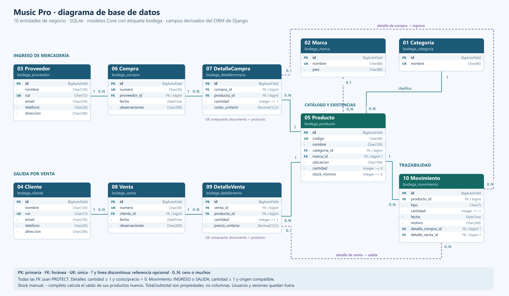

# Music Pro: inventario, base de datos y Django Admin

Proyecto de bodega para Music Pro con **diez tablas propias del negocio**: categorías, marcas, proveedores, clientes, productos, compras, detalles de compras, ventas, detalles de ventas y movimientos. Permite consultar existencias y seguir el origen de ingresos y salidas por venta desde Django Admin. El desarrollo toma los elementos de aprendizaje de `django-examples-main` y los aplica al caso propio: configuración, modelos relacionados, migraciones, Admin y datos ficticios. Las decisiones y equivalencias están en [correspondencia con el proyecto de apoyo](docs/correspondencia_referencia.md).

La base utilizada es **SQLite**. Django trabaja con el archivo `db.sqlite3`, ubicado junto a `manage.py`, salvo que se configure otra ruta para un ensayo. La evaluación 2 se centra en la base de datos y el CRUD de **Django Admin**. La aplicación utiliza únicamente las pantallas incorporadas del administrador. La pauta separa esa evaluación del CRUD web de E3 y de la etapa posterior con API REST/JWT.

Esta guía está organizada en las seis partes de la evaluación. Los comandos se ejecutan en **PowerShell**, dentro de la carpeta del proyecto que contiene `manage.py`. Cada bloque explica para qué sirve.

## Inicio rápido del servidor

Si ya instalaste el entorno y las dependencias, haz doble clic en [servidor.bat](servidor.bat). También puedes ejecutarlo desde PowerShell:

```powershell
.\servidor.bat
```

El archivo se ubica automáticamente en la carpeta del proyecto y utiliza Python de `.venv`, sin activar el entorno manualmente. Mantén abierta la ventana y entra a <http://127.0.0.1:8000/admin/> para ver las diez tablas. Detén el servidor con **Ctrl+C**.

Si el puerto 8000 está ocupado, puedes elegir otro:

```powershell
.\servidor.bat 8001
```

En ese caso, abre <http://127.0.0.1:8001/admin/>. El lanzador usa el entorno `.venv`; si configuraste otro nombre, ajusta la ruta de Python dentro del archivo.

## Material para estudiar y presentar

| Documento | Para qué utilizarlo |
| --- | --- |
| [README_ADMIN.md](README_ADMIN.md) | Recorrer el CRUD, filtros, búsquedas, formularios y permisos |
| [README_MIGRACIONES.md](README_MIGRACIONES.md) | Explicar el historial y aplicar futuros cambios de modelos |
| [README_SEEDER.md](README_SEEDER.md) | Instalar Faker, entender los lotes y demostrar las cuatro cargas |
| [Rúbrica E2 y evidencias](docs/rubrica_e2.md) | Relacionar los diez indicadores con el proyecto y preparar la defensa |
| [Diagramas y diccionario de datos](docs/diagrama_bd.md) | Revisar las entidades, atributos, claves y relaciones reales |
| [Todos los diagramas](docs/diagramas.md) | Abrir el modelo exigido y los esquemas de arquitectura y carga |
| [Tablas existentes](docs/tablas_bd.md) | Ubicar las diez tablas de negocio y distinguir las diez tablas internas de Django |
| [VERIFICACION.md](VERIFICACION.md) | Consultar resultados de comprobaciones y cargas efectivamente ejecutadas |
| [README_GITHUB.md](README_GITHUB.md) | Preparar 15 commits por componentes y publicar el proyecto en GitHub |

## Preparación: Python, entorno e instalación de Faker

Abre la carpeta en VS Code y luego **Terminal > Nueva terminal**. Comprueba que Python esté instalado:

```powershell
py --version
```

Muestra la versión de Python disponible. Django 6.1 admite Python 3.12, 3.13 y 3.14; utiliza una de esas versiones ([compatibilidad oficial](https://docs.djangoproject.com/en/6.1/releases/6.1/#python-compatibility)). La copia comprobada usa Python 3.12 dentro de `.venv`, y también puedes crear un entorno nuevo con Python 3.14.

Si todavía no tienes un entorno virtual en esta copia, créalo y actívalo:

```powershell
py -m venv .venv
.\.venv\Scripts\Activate.ps1
```

- `venv` crea un entorno independiente para las dependencias del proyecto.
- `Activate.ps1` hace que `python` y `pip` usen ese entorno en la terminal actual.
- Si `.venv` ya existe y utiliza una versión compatible, basta con activarlo. Compruébalo con `python --version`. Si pertenece a Python 3.11 o anterior, o se movió desde otro equipo, crea otro entorno con `py -m venv .venv-e2` usando un intérprete compatible y activa `.\.venv-e2\Scripts\Activate.ps1`.

Instala las dependencias:

```powershell
python -m pip install -r requirements.txt
```

Lee `requirements.txt` e instala las mismas cinco utilidades y versiones declaradas en el proyecto de apoyo. **Este comando ya instala Faker**; no es necesario instalarlo otra vez ni instalar complementos para dibujar los diagramas.

| Dependencia fijada | Función dentro del proyecto |
| --- | --- |
| `asgiref==3.12.1` | Utilidades que Django utiliza para integrar código síncrono y asíncrono |
| `Django==6.1.1` | Framework, ORM, migraciones, formularios, autenticación y Admin |
| `Faker==40.40.0` | Generación de datos ficticios para la bodega |
| `sqlparse==0.6.0` | Análisis y formato de SQL utilizado por Django |
| `tzdata==2026.5` | Datos de zonas horarias, necesarios especialmente en Windows |

El archivo se llama **`requirements.txt`**. SQLite forma parte de la biblioteca estándar de Python; no se instala como un paquete adicional.

Si Django ya está instalado y solamente necesitas añadir Faker, el comando específico es:

```powershell
python -m pip install Faker==40.40.0
```

Comprueba la instalación:

```powershell
python --version
python -m django --version
python -m pip show Faker
python -m pip check
python -c "from faker import Faker; print(Faker('es_CL').name())"
```

Los comandos muestran el intérprete activo, la versión de Django y la instalación de Faker. `pip check` comprueba que las dependencias instaladas sean compatibles entre sí. El último genera un nombre ficticio con la configuración regional chilena; su salida cambia entre ejecuciones.

**Faker es una biblioteca de Python y no se agrega a `INSTALLED_APPS`.** Se importa con `from faker import Faker` en el comando que genera los datos.

Si aparece `No module named pip`, instala pip en el entorno y repite la instalación de dependencias:

```powershell
python -m ensurepip --upgrade
python -m pip install -r requirements.txt
```

Si PowerShell bloquea la activación, puedes utilizar directamente el intérprete sin cambiar las políticas del equipo:

```powershell
.\.venv\Scripts\python.exe -m pip install -r requirements.txt
.\.venv\Scripts\python.exe manage.py check
```

En el resto de la guía, reemplaza `python` por `.\.venv\Scripts\python.exe` si usas esta alternativa. Si creaste `.venv-e2`, usa su ruta en lugar de `.venv`. En VS Code, selecciona ese mismo archivo con **Python: Select Interpreter**.

## Estructura del proyecto

```text
musicpro_e2/
  manage.py                       Comandos de Django
  servidor.bat                    Inicio del servidor con doble clic
  requirements.txt                Las cinco dependencias y sus versiones
  README.md                       Guía paso a paso
  README_ADMIN.md                 Administración, CRUD y permisos
  README_MIGRACIONES.md           Historial y cambios de estructura
  README_SEEDER.md                Faker, opciones y cargas por lotes
  VERIFICACION.md                  Evidencia de las comprobaciones realizadas
  musicpro_backend/
    settings.py                   Configuración y conexión SQLite
    urls.py                       Rutas y acceso a Django Admin
  Core/
    apps.py                       Módulo Core; etiqueta de aplicación bodega
    models.py                     Entidades, campos y relaciones
    admin.py                      CRUD, columnas, filtros y búsquedas
    tests.py                      Pruebas del CRUD y las consultas
    test_database.py              Pruebas de integridad y carga de datos
    migrations/                   Historial de cambios de estructura
    management/commands/
      cargar_datos.py              Generación de datos ficticios
      verificar_bd.py              Diagnóstico de conexión, tablas y conteos
  docs/
    diagrama_bd.md                Diagrama y diccionario de datos
    diagrama_bd.svg               Diagrama que abre cualquier navegador
    diagrama_bd.png               Imagen del diagrama para la entrega
    diagrama_arquitectura.png     Flujo de componentes de la aplicación
    flujo_carga.png               Generación, guardado y verificación con Faker
    rubrica_e2.md                  Indicadores, evidencia y defensa
    correspondencia_referencia.md Decisiones de adaptación
  db.sqlite3                      Base de datos local
  .venv/                          Entorno virtual; no modificar su código
```

La aplicación está físicamente en `Core`, por eso los imports usan `from Core.models import ...`. Su etiqueta de Django es `bodega` para conservar las tablas `bodega_*` y las migraciones existentes. Por eso los comandos de migración usan `bodega`. La carpeta de configuración se llama `musicpro_backend`.

## 1. Configuración y conexión de la base de datos

La conexión se define en `musicpro_backend/settings.py`, dentro de `DATABASES`:

| Opción | Valor y propósito |
| --- | --- |
| Alias | `default`: conexión utilizada por la aplicación |
| `ENGINE` | `django.db.backends.sqlite3`: motor SQLite |
| `NAME` | Ruta a `db.sqlite3`, o la indicada por `MUSICPRO_DB_PATH` |
| `OPTIONS.timeout` | `30`: espera hasta 30 segundos si SQLite está ocupado |

SQLite guarda la base en un archivo y no necesita instalar un servidor de MySQL o PostgreSQL. El mismo archivo contiene las tablas del inventario y las tablas internas de Django para usuarios, permisos, sesiones y migraciones.

Primero revisa la configuración y aplica la estructura de la base:

```powershell
python manage.py check
python manage.py migrate
python manage.py verificar_bd
```

- `check` detecta errores de configuración de Django; por sí solo no demuestra que las tablas existan.
- `migrate` aplica las migraciones pendientes y crea las tablas en la conexión configurada.
- `verificar_bd` abre la conexión, identifica el motor y la ruta, comprueba las tablas del inventario, muestra sus conteos y revisa migraciones pendientes. Ante un problema informa el error.

También puedes revisar la conexión directamente desde el ORM:

```powershell
python manage.py shell -c "from django.db import connection; connection.ensure_connection(); print('Motor:', connection.vendor); print('Archivo:', connection.settings_dict['NAME']); print('Tablas:', connection.introspection.table_names())"
```

`shell -c` ejecuta código Python con Django preparado. `ensure_connection()` abre la conexión real; la introspección consulta las tablas presentes.

Las **diez tablas de negocio** son `bodega_categoria`, `bodega_marca`, `bodega_proveedor`, `bodega_cliente`, `bodega_producto`, `bodega_compra`, `bodega_detallecompra`, `bodega_venta`, `bodega_detalleventa` y `bodega_movimiento`. Están definidas en `Core/models.py` y disponibles en Admin bajo **Bodega**. [Consulta sus nombres, funciones y pantallas](docs/tablas_bd.md). Este requisito adicional de diez tablas fue confirmado por el estudiante como una indicación del profesor; los diez indicadores de la rúbrica son un requisito distinto. Para los ensayos grandes puedes seleccionar otro archivo SQLite con `MUSICPRO_DB_PATH`; la sección 6 muestra cómo hacerlo.

## 2. Modelamiento de datos

Los modelos están implementados en `Core/models.py`. Un modelo representa una entidad; cada instancia es un registro y cada atributo es un campo.

| Modelo | Campos principales | Reglas |
| --- | --- | --- |
| `Categoria` | `id`, `nombre` | Nombre obligatorio y único, máximo 80 caracteres |
| `Marca` | `id`, `nombre`, `pais` | Nombre único; país opcional |
| `Proveedor` | `id`, `nombre`, `rut`, `email`, `telefono`, `direccion` | RUT único; datos de contacto opcionales |
| `Cliente` | `id`, `nombre`, `rut`, `email`, `telefono`, `direccion` | RUT único; datos de contacto opcionales |
| `Producto` | `id`, `codigo`, `nombre`, `categoria`, `marca`, `ubicacion`, `cantidad`, `stock_minimo` | Código único; cantidades no negativas; categoría obligatoria y marca opcional |
| `Compra` | `id`, `numero`, `proveedor`, `fecha`, `observaciones` | Número único; proveedor obligatorio |
| `DetalleCompra` | `id`, `compra`, `producto`, `cantidad`, `costo_unitario` | Cantidad ≥ 1; costo > 0; par compra/producto único |
| `Venta` | `id`, `numero`, `cliente`, `fecha`, `observaciones` | Número único; cliente obligatorio |
| `DetalleVenta` | `id`, `venta`, `producto`, `cantidad`, `precio_unitario` | Cantidad ≥ 1; precio > 0; par venta/producto único |
| `Movimiento` | `id`, `producto`, `tipo`, `cantidad`, `fecha`, `motivo`, `detalle_compra`, `detalle_venta` | Cantidad ≥ 1; solo `INGRESO` o `SALIDA`; origen opcional y coherente con el tipo |

Los tipos utilizados son:

- `BigAutoField`: clave primaria `id`, agregada automáticamente por Django.
- `CharField`: texto con longitud máxima, como nombre, código, ubicación y motivo.
- `PositiveIntegerField`: enteros no negativos. En detalles y movimientos se añaden validadores y restricciones para exigir al menos una unidad.
- `DateTimeField`: fecha y hora de compras, ventas y movimientos; el valor por defecto usa `timezone.now`.
- `EmailField`: correo opcional de clientes y proveedores.
- `DecimalField(max_digits=12, decimal_places=2)`: costos y precios unitarios, conservando dos decimales.
- `ForeignKey`: relación con otra entidad. En la tabla se guarda el identificador relacionado, por ejemplo `categoria_id`, `producto_id` o `cliente_id`.

Una categoría puede tener muchos productos y cada producto pertenece a una categoría; la marca del producto es opcional. Un proveedor puede tener varias compras y un cliente varias ventas. Cada documento tiene detalles, y cada detalle identifica un producto, su cantidad y valor unitario. Los movimientos pertenecen a un producto y pueden vincularse a un detalle de compra (ingreso) o de venta (salida). Todas las claves foráneas usan `on_delete=models.PROTECT`, que protege los registros utilizados por otros.

`unique=True` evita duplicados en nombres de categorías/marcas, RUT, códigos y números de documentos. `UniqueConstraint` evita repetir el mismo producto dentro de una compra o venta. Las restricciones `CheckConstraint` exigen cantidades válidas, costos/precios positivos y un origen de movimiento coherente: un ingreso no puede vincularse a una venta y una salida no puede vincularse a una compra. La validación `clean()` además comprueba el producto del detalle y que la cantidad del movimiento no supere su cantidad. Estas dos comprobaciones entre tablas se ejecutan mediante formularios o `full_clean()`; `save()` y `bulk_create()` no llaman automáticamente a `full_clean()`. El índice de movimientos por `-fecha, -id` acompaña la consulta de los movimientos más recientes.

**El stock del producto se administra manualmente.** Crear, editar o eliminar un movimiento no modifica automáticamente `Producto.cantidad`. Para esta etapa, los movimientos registran información; si cambia el stock, debes editar también el producto. La opción `--con-movimientos` crea un ingreso inicial coherente. La opción `--completo` crea compras, ventas y sus movimientos, dejando el stock de cada producto nuevo igual a lo recibido menos lo vendido. `total` de documentos y `subtotal` de detalles son valores calculados en Python, no columnas adicionales.

## 3. Diagrama de la base de datos

Consulta [el diagrama y diccionario de datos](docs/diagrama_bd.md), abre [el diagrama SVG](docs/diagrama_bd.svg) en un navegador o utiliza [la imagen PNG](docs/diagrama_bd.png) para la entrega. El SVG se puede imprimir sin instalar programas adicionales. El documento Markdown también incluye el diagrama Mermaid para visores compatibles.



El diagrama identifica:

- Las diez entidades del negocio y sus nombres reales de tabla.
- Todos los atributos, tipos de Django y claves primarias (`PK`).
- Campos únicos (`UK`) y claves foráneas (`FK`).
- Las relaciones de catálogos, documentos, detalles y movimientos, con cardinalidades y referencias opcionales.
- Las reglas de integridad y la protección de registros relacionados.

Cuando cambies un modelo, actualiza el diagrama y el diccionario de datos junto con la migración correspondiente. Las tablas internas de autenticación y sesiones de Django quedan fuera de este diagrama del inventario.

La **imagen del modelo de base de datos** es el diagrama solicitado como entregable. Para explicar el funcionamiento también se incluyen [la arquitectura](docs/diagrama_arquitectura.png) y [el flujo de la carga Faker](docs/flujo_carga.png), con sus versiones [SVG de arquitectura](docs/diagrama_arquitectura.svg) y [SVG de carga](docs/flujo_carga.svg). Estos dos últimos son apoyos para la defensa.

## 4. Migraciones e historial

Las migraciones describen los cambios de estructura en archivos Python versionables. `makemigrations` genera esos archivos a partir de los modelos; `migrate` ejecuta los cambios en la base. La tabla `django_migrations` registra cuáles fueron aplicadas.

Comprueba el historial:

```powershell
python manage.py showmigrations bodega
python manage.py migrate --plan
```

- `showmigrations bodega` lista las migraciones de la aplicación. `[X]` indica una migración aplicada y `[ ]` una pendiente.
- `migrate --plan` muestra las operaciones pendientes antes de aplicarlas.

El historial en `Core/migrations/` conserva estos cambios; [la guía de migraciones](README_MIGRACIONES.md) permite explicar uno de ellos paso a paso:

| Migración | Para qué sirve |
| --- | --- |
| `0001_initial` | Crea las tres entidades, claves y relaciones |
| `0002_producto_stock_minimo` | Añade el campo `stock_minimo` al producto |
| `0003_integridad_movimientos` | Añade restricciones de cantidad y tipo, índice de movimientos y nombres legibles en Admin |
| `0004_normalizar_motivos_movimientos` | Corrige datos: ingresos como recepción de mercadería y salidas de venta como «Por venta» |
| `0005_diez_tablas_bodega` | Añade siete modelos de negocio, marca opcional y origen documental de movimientos; conserva las tres tablas originales |

Para inspeccionar el SQL de una migración sin ejecutarlo:

```powershell
python manage.py sqlmigrate bodega 0001
python manage.py sqlmigrate bodega 0002
python manage.py sqlmigrate bodega 0003
python manage.py sqlmigrate bodega 0005
```

`sqlmigrate` muestra las sentencias que Django usaría para esa migración en el motor configurado.

Después de modificar `Core/models.py`, sigue este orden:

```powershell
python manage.py makemigrations bodega
python manage.py migrate --plan
python manage.py migrate
python manage.py showmigrations bodega
python manage.py verificar_bd
```

1. `makemigrations bodega` crea una nueva migración para el cambio; si no hay cambios, lo informa.
2. `migrate --plan` permite revisar lo que se aplicará.
3. `migrate` actualiza la estructura de la base.
4. `showmigrations` confirma el estado del historial.
5. `verificar_bd` vuelve a comprobar la conexión y las tablas.

Por ejemplo, añadir un campo al modelo y ejecutar `makemigrations` produce otra migración; **no se edita una migración anterior ya aplicada ni se borra el historial para empezar de nuevo**. Si añades un campo obligatorio a una tabla con datos, debes decidir su valor inicial o permitir valores vacíos según el caso.

Para comprobar que los modelos actuales tienen su migración correspondiente, sin crear archivos:

```powershell
python manage.py makemigrations --check --dry-run
```

Si detecta cambios pendientes, el comando devuelve un error para que generes y revises la migración faltante.

## 5. Django Admin: CRUD, filtros y búsquedas

Los diez modelos están registrados en `Core/admin.py`, dentro de **Bodega**. Las tablas de usuarios, grupos y sesiones son infraestructura y no se cuentan como tablas del negocio. Crea tu cuenta administradora y ejecuta el servidor:

```powershell
python manage.py createsuperuser
python manage.py runserver
```

- `createsuperuser` solicita usuario, correo y contraseña para acceder a la administración. La contraseña no se muestra mientras la escribes.
- `runserver` inicia el servidor local. Entra en [Django Admin](http://127.0.0.1:8000/admin/) con la cuenta creada. Detén el servidor con `Ctrl+C`.


| Modelo | Columnas y consultas | Filtros |
| --- | --- | --- |
| Categorías | Identificador y nombre; búsqueda por nombre | Consulta desde su listado |
| Marcas | Nombre y país; búsqueda por ambos | País |
| Proveedores y clientes | Nombre, RUT, correo y teléfono; búsqueda por datos de contacto | Consulta desde cada listado |
| Productos | Código, nombre, categoría, marca, ubicación, cantidad, mínimo y estado de stock; búsqueda por identificación y ubicación | Categoría, marca y stock crítico |
| Compras y ventas | Número, contraparte y fecha; total calculado y detalles dentro del formulario | Fecha y contraparte |
| Detalles de compras y ventas | Documento, producto, cantidad, valor unitario y subtotal calculado | Fecha del documento |
| Movimientos | Producto, tipo, cantidad, fecha y motivo; referencias de origen dentro del formulario; búsqueda por producto, motivo y documento | Tipo, fecha y navegación por fecha |

En Django Admin, abre Movimientos y utiliza el filtro **Tipo** para consultar ingresos o salidas. Los ingresos de muestra muestran «Recepción de mercadería»; las salidas por venta muestran «Por venta». Para registrar una salida, pulsa Añadir movimiento, selecciona SALIDA e indica «Por venta» como motivo.

El estado de **stock crítico** corresponde a `cantidad <= stock_minimo`. Los formularios tienen autocompletado para seleccionar productos y relaciones; así no cargan un selector con todos los productos cuando hay un millón de registros. Los listados usan paginación, consultas de relaciones mediante `select_related` y evitan un conteo adicional del conjunto completo al filtrar. Las búsquedas de texto y los conteos de conjuntos grandes aún pueden tardar, especialmente en SQLite.

La personalización incluye el encabezado **Music Pro - Bodega**, el título del sitio, nombres legibles de los modelos, las columnas de cada listado, campos organizados por secciones e identificadores de solo lectura. [La guía del Admin](README_ADMIN.md) explica qué propiedad configura cada comportamiento y cómo asignar permisos.

### Demostración del CRUD con el docente

1. **Crear:** en Categorías, crea `Prueba docente`; en Productos, añade código `DEMO-001`, nombre `Guitarra de prueba`, categoría `Prueba docente`, ubicación `Pasillo 1`, cantidad `10` y stock mínimo `5`.
2. **Consultar:** busca `DEMO-001` en Productos. Filtra por su categoría y abre su ficha. La información está guardada en SQLite.
3. **Modificar:** cambia la ubicación a `Pasillo 2` y la cantidad a `3`; guarda. El producto debe aparecer en el filtro de stock crítico.
4. **Relacionar:** crea un movimiento para ese producto, tipo `INGRESO`, cantidad `3` y motivo `Demostración`. Muestra la relación con el producto y los filtros de movimientos.
5. **Validar:** intenta guardar un movimiento con cantidad `0`; el formulario debe rechazarlo. Intenta eliminar el producto con un movimiento asociado; Django debe protegerlo.
6. **Eliminar:** elimina el movimiento de demostración y después el producto. Elimina la categoría cuando ya no tenga productos. Confirma desde el listado que los registros desaparecieron.

Estos pasos usan solo registros creados para la demostración. Recuerda que el movimiento del paso 4 no altera por sí mismo la cantidad del producto.

## 6. Generación de datos ficticios con Faker

El comando `cargar_datos` usa Faker con configuración `es_CL` para generar productos de ejemplo y reutiliza las categorías `Instrumentos`, `Audio` y `Accesorios`. Genera códigos únicos por ejecución, nombres de artículos, ubicaciones, cantidades y stock mínimo.

La [guía específica de Faker](README_SEEDER.md) explica cómo repetir la demostración y por qué una misma semilla no sobrescribe registros.

Revisa sus opciones antes de cargar:

```powershell
python manage.py cargar_datos --help
```

| Opción | Para qué sirve |
| --- | --- |
| `--cantidad N` | Añade exactamente N productos nuevos; admite desde 1 hasta 1.000.000 |
| `--lote N` | Procesa grupos de N productos; admite desde 1 hasta 10.000 y usa 1.000 por defecto |
| `--semilla N` | Fija la semilla de Faker para repetir valores ficticios; los códigos siguen distinguiendo cada ejecución |
| `--con-movimientos` | Crea un ingreso por cada producto nuevo, con cantidad igual a su stock inicial y motivo «Recepción de mercadería» |
| `--completo` | Simula compras y ventas: por producto crea compra + detalle, venta + detalle y dos movimientos; reutiliza catálogos de marca/proveedor/cliente |
| `--database default` | Selecciona el alias de conexión; este proyecto configura `default` |

### Primera carga y comprobación

```powershell
python manage.py verificar_bd
python manage.py cargar_datos --cantidad 100 --semilla 42
python manage.py verificar_bd
```

El primer diagnóstico permite anotar el total inicial. La carga añade 100 productos y muestra el avance y los conteos antes/después. El segundo diagnóstico permite comprobar los registros almacenados. Las categorías se crean únicamente si aún no existen.

Consulta una muestra directamente en la base mediante el ORM:

```powershell
python manage.py shell -c "from Core.models import Categoria, Producto, Movimiento; print('Categorías:', Categoria.objects.count()); print('Productos:', Producto.objects.count()); print('Movimientos:', Movimiento.objects.count()); print(list(Producto.objects.order_by('-id').values('codigo', 'nombre', 'categoria__nombre', 'ubicacion', 'cantidad', 'stock_minimo')[:5]))"
```

`count()` cuenta filas guardadas; `values()` muestra campos de los últimos cinco productos. Luego puedes buscarlos en Admin por su código para comprobar que ambos consultan la misma información.

Si quieres probar también la tabla de movimientos:

```powershell
python manage.py cargar_datos --cantidad 100 --semilla 42 --con-movimientos
python manage.py verificar_bd
```

Esta ejecución añade **100 productos más y 100 movimientos de ingreso**. Los productos de esta modalidad tienen stock entre 1 y 100; el ingreso inicial tiene esa misma cantidad. Sin `--con-movimientos`, el stock puede ser de 0 a 100 y no se crean movimientos.

### Simular una bodega con las diez tablas

```powershell
python manage.py migrate
python manage.py cargar_datos --cantidad 100 --semilla 42 --completo
python manage.py verificar_bd
```

`migrate` aplica la ampliación a diez tablas. `--completo` añade **100 productos, 100 compras, 100 detalles de compras, 100 ventas, 100 detalles de ventas y 200 movimientos**, además de pequeños catálogos de categorías, marcas, proveedores y clientes creados o reutilizados. No borra datos existentes. `--completo` ya incluye movimientos; no necesitas añadir `--con-movimientos`.

Abre **Bodega** en Admin para ver los diez modelos. Revisa una compra y sus detalles; busca después su movimiento con motivo **Recepción de mercadería**. Revisa una venta y su detalle; su movimiento de salida debe decir **Por venta**. El stock generado es la diferencia entre recepción y venta. Los contactos y documentos de esta simulación son ficticios.

Para consultar una salida con su origen documental:

```powershell
python manage.py shell -c "from Core.models import Movimiento; print(list(Movimiento.objects.filter(tipo='SALIDA', detalle_venta__isnull=False).order_by('-id').values('producto__codigo', 'motivo', 'cantidad', 'detalle_venta__venta__numero', 'detalle_venta__venta__cliente__nombre')[:5]))"
```

La consulta recupera producto, motivo, cantidad, número de venta y cliente directamente de las tablas relacionadas.

### Cargas de 100, 1.000, 100.000 y 1.000.000 con el docente

Estos son los cuatro comandos de la pauta:

```powershell
python manage.py cargar_datos --cantidad 100
python manage.py cargar_datos --cantidad 1000
python manage.py cargar_datos --cantidad 100000
python manage.py cargar_datos --cantidad 1000000
```

**Cada comando añade registros.** Si ejecutas los cuatro sobre una base inicialmente vacía, tendrás **1.101.100 productos**, más cualquier carga adicional. No significan dejar la tabla con el total indicado. Las tres categorías son registros adicionales y no forman parte de `--cantidad`.

Para comparar volúmenes de forma independiente y conservar `db.sqlite3`, usa un archivo diferente para cada prueba. Ejecuta el siguiente bloque con el volumen deseado:

```powershell
$cantidadEnsayo = 100
$env:MUSICPRO_DB_PATH = Join-Path (Get-Location) ("ensayo-" + $cantidadEnsayo + "-" + (Get-Date -Format "yyyyMMdd-HHmmss-fff") + ".sqlite3")
python manage.py migrate
python manage.py verificar_bd
Measure-Command { python manage.py cargar_datos --cantidad $cantidadEnsayo --lote 1000 --semilla 42 }
python manage.py verificar_bd
```

- `$cantidadEnsayo` indica cuántos productos generar. Usa `100`, `1000`, `100000` o `1000000` y repite todo el bloque para cada volumen.
- `MUSICPRO_DB_PATH` selecciona un archivo nuevo con fecha y hora en su nombre; afecta solo a esta terminal y a los procesos que abras desde ella.
- `migrate` prepara ese archivo con las mismas tablas y restricciones.
- `verificar_bd` muestra la ruta activa y permite comprobar que la tabla de productos inicia vacía.
- `Measure-Command` mide el tiempo de la carga en tu equipo.
- Al comparar los diagnósticos inicial y final, la diferencia de productos debe ser igual a `$cantidadEnsayo`; el diagnóstico final debe indicar que no hay migraciones pendientes.

Para abrir en Admin la base del ensayo, ejecuta `createsuperuser` y `runserver` en esa misma terminal. Cada archivo nuevo tiene sus propios usuarios. Detén cualquier servidor anterior antes de arrancarlo sobre otra base.

Al terminar el ensayo, vuelve a la base habitual:

```powershell
Remove-Item Env:MUSICPRO_DB_PATH
python manage.py verificar_bd
```

Esto quita la variable de la terminal, **no elimina ningún archivo ni registro**. El diagnóstico debe volver a mostrar `db.sqlite3`. Los archivos de ensayo quedan guardados para revisar sus resultados.

El comando acumula un lote de productos y, según la modalidad, sus movimientos o documentos/detalles relacionados en memoria; usa `bulk_create` para insertarlos por grupos. Durante la carga desactiva temporalmente `DEBUG` para que Django no retenga el SQL de todas las inserciones. Cada lote se guarda en una transacción. Así evita una inserción individual por cada producto y no necesita construir una lista con un millón de objetos. Si la ejecución se interrumpe, los lotes ya confirmados permanecen; repetir el comando añade una carga nueva. `bulk_create` no ejecuta el `save()` individual ni la validación de un formulario, por lo que el generador construye valores válidos y las restricciones de la base siguen siendo necesarias.

Las cargas grandes consumen tiempo y espacio; los resultados y tiempos medidos se registran en [VERIFICACION.md](VERIFICACION.md). No hay una duración garantizada para otro equipo. Si usas `--con-movimientos` con un millón de productos, también generarás un millón de movimientos. `--completo` añade cinco millones de filas de productos/documentos/detalles y dos millones de movimientos, además de catálogos. Para la carga de volumen puedes usar la modalidad básica; muestra las diez tablas con una carga completa pequeña. Los tiempos anteriores de la modalidad básica no predicen el costo de la modalidad completa.

## Comprobaciones antes de presentar

```powershell
python manage.py check
python manage.py makemigrations --check --dry-run
python manage.py showmigrations bodega
python manage.py verificar_bd
python manage.py test Core
```

| Comando | Qué comprueba |
| --- | --- |
| `check` | Configuración general y registro de modelos |
| `makemigrations --check --dry-run` | Que no falten migraciones para los modelos actuales |
| `showmigrations bodega` | Historial de migraciones y estado aplicado |
| `verificar_bd` | Conexión, tablas, conteos y migraciones pendientes |
| `test Core` | Pruebas automáticas en una base temporal de pruebas |

Presenta los modelos, el diagrama, las migraciones, el CRUD de Admin y los conteos antes/después de cada carga. Conserva las migraciones en el repositorio; el entorno virtual, los archivos SQLite y sus cachés no se incluyen en el código compartido. Para reconstruir una base nueva bastan la instalación, `migrate`, la creación del superusuario y la carga de datos.

## Preparar la entrega en GitHub

La pauta solicita subir **la imagen del modelo de base de datos** y **el enlace del repositorio público con el último commit**. Utiliza `docs/diagrama_bd.png` como imagen. La defensa individual debe realizarse y explicarse ante el docente; las comprobaciones automáticas no reemplazan esa instancia.

Comprueba primero el estado del repositorio:

```powershell
git status
git diff
```

`status` muestra los archivos pendientes; `diff` permite revisar las modificaciones antes de guardarlas. Si Git informa que esta carpeta todavía no es un repositorio, inicialízalo una sola vez:

```powershell
git init
```

Prepara y revisa la versión que entregarás:

```powershell
git add .
git diff --cached --stat
git status
git commit -m "Implementa inventario Music Pro para evaluacion 2"
```

`git add` prepara los archivos permitidos por `.gitignore`; revisa que no incluya entornos virtuales, bases SQLite ni información privada. `diff --cached --stat` resume lo preparado y `commit` guarda esa versión en el historial local. `.gitignore` ya excluye los entornos `.venv*`, incluida `.venv-e2`. Si no hay cambios pendientes, conserva el commit existente.

Crea un repositorio **público** vacío en GitHub, sin README generado, y utiliza su dirección real. Revisa si ya existe un remoto antes de añadir otro:

```powershell
git remote -v
git branch --show-current
```

El primer comando muestra a qué repositorio apunta `origin`; el segundo muestra tu rama. Si aún no hay `origin`, sustituye `TU_USUARIO` y `TU_REPOSITORIO` por los valores reales y ejecuta:

```powershell
git remote add origin "https://github.com/TU_USUARIO/TU_REPOSITORIO.git"
```

Publica la rama actual:

```powershell
$ramaEntrega = git branch --show-current
git push -u origin $ramaEntrega
git log -1 --oneline
```

`push` sube los commits al remoto; `log -1` muestra el identificador del último commit para compararlo con GitHub. Verifica desde GitHub que el repositorio sea público, que aparezca ese commit y que las guías y diagramas abran correctamente. El enlace público y la defensa son pasos de entrega pendientes hasta que se realicen; este README no afirma que el repositorio haya sido publicado.

## Referencias

- [Instalación y uso de Faker](https://faker.readthedocs.io/en/master/)
- [Migraciones de Django](https://docs.djangoproject.com/en/6.1/topics/migrations/)
- [Campos de modelos de Django](https://docs.djangoproject.com/en/6.1/ref/models/fields/)
- [Restricciones de modelos de Django](https://docs.djangoproject.com/en/6.1/ref/models/constraints/)
- [Administración de Django](https://docs.djangoproject.com/en/6.1/ref/contrib/admin/)
