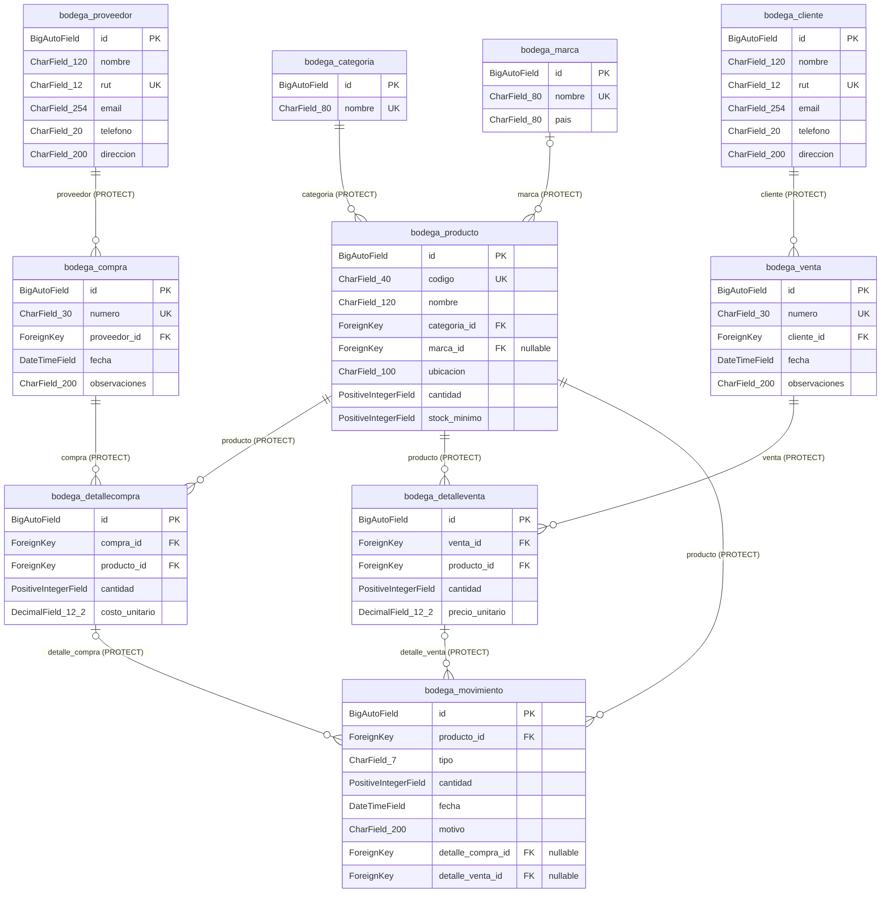

# Diagrama de la base de datos de Music Pro

El modelo contiene **diez tablas propias del negocio**, según el requisito adicional del profesor confirmado por el estudiante. Se deriva de los diez modelos de [Core/models.py](../Core/models.py), con etiqueta `bodega` y conexión SQLite. Las tablas internas de usuarios, sesiones y migraciones se distinguen en [el listado de tablas](tablas_bd.md).

**Para subir a la plataforma utiliza una imagen: [diagrama_bd.png](diagrama_bd.png).** Contiene las diez entidades, todos sus campos, claves y relaciones. [La versión SVG](diagrama_bd.svg) permite ampliar sin perder calidad.




**Leyenda:** PK = clave primaria; FK = clave foránea; UK = campo único. En Mermaid, `||--o{` indica que cada fila del lado derecho tiene exactamente un padre y que el padre puede tener cero o muchas filas hijas. `|o--o{` indica que la referencia al padre es opcional (cero o uno); el padre igualmente admite cero o muchas filas hijas. En la imagen, las referencias opcionales llevan línea discontinua y `?` en el campo. Las cardinalidades se leen junto a cada extremo, sin exigir que un documento ya tenga detalles.

## Diccionario de datos

Los tipos son los del ORM de Django, no una declaración de tipos físicos de SQLite. `BigAutoField` se representa como entero autogenerado en SQLite. Solo `Producto.marca_id`, `Movimiento.detalle_compra_id` y `Movimiento.detalle_venta_id` admiten `NULL`. `blank=True` en campos de contacto, país y observaciones permite texto vacío en el formulario y no añade tablas.

### 1. Categoria: `bodega_categoria`

| Campo en la tabla | Tipo Django | Clave | Reglas |
| --- | --- | --- | --- |
| `id` | `BigAutoField` | PK | Identificador autogenerado por Django |
| `nombre` | `CharField(80)` | UK | Único, no admite duplicados; Obligatorio |

### 2. Marca: `bodega_marca`

| Campo en la tabla | Tipo Django | Clave | Reglas |
| --- | --- | --- | --- |
| `id` | `BigAutoField` | PK | Identificador autogenerado por Django |
| `nombre` | `CharField(80)` | UK | Único, no admite duplicados; Obligatorio |
| `pais` | `CharField(80)` | — | Texto opcional en formularios; se guarda vacío, no NULL |

### 3. Proveedor: `bodega_proveedor`

| Campo en la tabla | Tipo Django | Clave | Reglas |
| --- | --- | --- | --- |
| `id` | `BigAutoField` | PK | Identificador autogenerado por Django |
| `nombre` | `CharField(120)` | — | Obligatorio |
| `rut` | `CharField(12)` | UK | Único, no admite duplicados; Obligatorio |
| `email` | `CharField(254)` | — | Texto opcional en formularios; se guarda vacío, no NULL |
| `telefono` | `CharField(20)` | — | Texto opcional en formularios; se guarda vacío, no NULL |
| `direccion` | `CharField(200)` | — | Texto opcional en formularios; se guarda vacío, no NULL |

### 4. Cliente: `bodega_cliente`

| Campo en la tabla | Tipo Django | Clave | Reglas |
| --- | --- | --- | --- |
| `id` | `BigAutoField` | PK | Identificador autogenerado por Django |
| `nombre` | `CharField(120)` | — | Obligatorio |
| `rut` | `CharField(12)` | UK | Único, no admite duplicados; Obligatorio |
| `email` | `CharField(254)` | — | Texto opcional en formularios; se guarda vacío, no NULL |
| `telefono` | `CharField(20)` | — | Texto opcional en formularios; se guarda vacío, no NULL |
| `direccion` | `CharField(200)` | — | Texto opcional en formularios; se guarda vacío, no NULL |

### 5. Producto: `bodega_producto`

| Campo en la tabla | Tipo Django | Clave | Reglas |
| --- | --- | --- | --- |
| `id` | `BigAutoField` | PK | Identificador autogenerado por Django |
| `codigo` | `CharField(40)` | UK | Único, no admite duplicados; Obligatorio |
| `nombre` | `CharField(120)` | — | Obligatorio |
| `categoria_id` | `ForeignKey(Categoria, PROTECT)` | FK | Referencia a `bodega_categoria.id`; PROTECT; Obligatorio |
| `marca_id` | `ForeignKey(Marca, PROTECT)` | FK | Referencia a `bodega_marca.id`; PROTECT; Opcional: admite NULL |
| `ubicacion` | `CharField(100)` | — | Obligatorio |
| `cantidad` | `PositiveIntegerField` | — | Obligatorio; ≥ 0 |
| `stock_minimo` | `PositiveIntegerField` | — | Obligatorio; ≥ 0; por defecto 5 |

### 6. Compra: `bodega_compra`

| Campo en la tabla | Tipo Django | Clave | Reglas |
| --- | --- | --- | --- |
| `id` | `BigAutoField` | PK | Identificador autogenerado por Django |
| `numero` | `CharField(30)` | UK | Único, no admite duplicados; Obligatorio |
| `proveedor_id` | `ForeignKey(Proveedor, PROTECT)` | FK | Referencia a `bodega_proveedor.id`; PROTECT; Obligatorio |
| `fecha` | `DateTimeField` | — | Obligatorio; Por defecto timezone.now |
| `observaciones` | `CharField(200)` | — | Texto opcional en formularios; se guarda vacío, no NULL |

### 7. DetalleCompra: `bodega_detallecompra`

| Campo en la tabla | Tipo Django | Clave | Reglas |
| --- | --- | --- | --- |
| `id` | `BigAutoField` | PK | Identificador autogenerado por Django |
| `compra_id` | `ForeignKey(Compra, PROTECT)` | FK | Referencia a `bodega_compra.id`; PROTECT; Obligatorio |
| `producto_id` | `ForeignKey(Producto, PROTECT)` | FK | Referencia a `bodega_producto.id`; PROTECT; Obligatorio |
| `cantidad` | `PositiveIntegerField` | — | Obligatorio; ≥ 1 |
| `costo_unitario` | `DecimalField(12, 2)` | — | Obligatorio; > 0; dos decimales |

Clave única compuesta: `(compra_id, producto_id)`, restricción `detalle_compra_producto_unico`. No se repite el mismo producto en el documento.

### 8. Venta: `bodega_venta`

| Campo en la tabla | Tipo Django | Clave | Reglas |
| --- | --- | --- | --- |
| `id` | `BigAutoField` | PK | Identificador autogenerado por Django |
| `numero` | `CharField(30)` | UK | Único, no admite duplicados; Obligatorio |
| `cliente_id` | `ForeignKey(Cliente, PROTECT)` | FK | Referencia a `bodega_cliente.id`; PROTECT; Obligatorio |
| `fecha` | `DateTimeField` | — | Obligatorio; Por defecto timezone.now |
| `observaciones` | `CharField(200)` | — | Texto opcional en formularios; se guarda vacío, no NULL |

### 9. DetalleVenta: `bodega_detalleventa`

| Campo en la tabla | Tipo Django | Clave | Reglas |
| --- | --- | --- | --- |
| `id` | `BigAutoField` | PK | Identificador autogenerado por Django |
| `venta_id` | `ForeignKey(Venta, PROTECT)` | FK | Referencia a `bodega_venta.id`; PROTECT; Obligatorio |
| `producto_id` | `ForeignKey(Producto, PROTECT)` | FK | Referencia a `bodega_producto.id`; PROTECT; Obligatorio |
| `cantidad` | `PositiveIntegerField` | — | Obligatorio; ≥ 1 |
| `precio_unitario` | `DecimalField(12, 2)` | — | Obligatorio; > 0; dos decimales |

Clave única compuesta: `(venta_id, producto_id)`, restricción `detalle_venta_producto_unico`. No se repite el mismo producto en el documento.

### 10. Movimiento: `bodega_movimiento`

| Campo en la tabla | Tipo Django | Clave | Reglas |
| --- | --- | --- | --- |
| `id` | `BigAutoField` | PK | Identificador autogenerado por Django |
| `producto_id` | `ForeignKey(Producto, PROTECT)` | FK | Referencia a `bodega_producto.id`; PROTECT; Obligatorio |
| `tipo` | `CharField(7)` | — | Obligatorio; INGRESO o SALIDA |
| `cantidad` | `PositiveIntegerField` | — | Obligatorio; ≥ 1 |
| `fecha` | `DateTimeField` | — | Obligatorio; Por defecto timezone.now |
| `motivo` | `CharField(200)` | — | Obligatorio |
| `detalle_compra_id` | `ForeignKey(DetalleCompra, PROTECT)` | FK | Referencia a `bodega_detallecompra.id`; PROTECT; Opcional: admite NULL |
| `detalle_venta_id` | `ForeignKey(DetalleVenta, PROTECT)` | FK | Referencia a `bodega_detalleventa.id`; PROTECT; Opcional: admite NULL |

## Relaciones y reglas de integridad

| Entidad referenciada → entidad que guarda la FK | Referencia desde cada fila hija | Filas hijas por padre |
| --- | --- | --- |
| Categoria → Producto (`categoria_id`) | 1 (obligatoria) | 0..N |
| Marca → Producto (`marca_id`) | 0..1 (opcional) | 0..N |
| Proveedor → Compra (`proveedor_id`) | 1 (obligatoria) | 0..N |
| Compra → DetalleCompra (`compra_id`) | 1 (obligatoria) | 0..N |
| Producto → DetalleCompra (`producto_id`) | 1 (obligatoria) | 0..N |
| Cliente → Venta (`cliente_id`) | 1 (obligatoria) | 0..N |
| Venta → DetalleVenta (`venta_id`) | 1 (obligatoria) | 0..N |
| Producto → DetalleVenta (`producto_id`) | 1 (obligatoria) | 0..N |
| Producto → Movimiento (`producto_id`) | 1 (obligatoria) | 0..N |
| DetalleCompra → Movimiento (`detalle_compra_id`) | 0..1 (opcional) | 0..N |
| DetalleVenta → Movimiento (`detalle_venta_id`) | 0..1 (opcional) | 0..N |

Todas las FK usan `on_delete=models.PROTECT`. El ORM impide borrar un registro utilizado por otro, por ejemplo un proveedor con compras, un producto con detalles o un detalle con movimientos. `PROTECT` es una regla del ORM y no una instrucción SQL llamada `ON DELETE PROTECT`.

Las restricciones de la base exigen cantidades de detalle/movimiento ≥ 1, costo/precio > 0, tipos de movimiento permitidos y origen coherente: un ingreso no admite `detalle_venta`, una salida no admite `detalle_compra`. Un movimiento puede no tener documento de origen, para conservar los registros anteriores y registrar otros ajustes de bodega. La validación `Movimiento.clean()` comprueba además que el producto coincida con el detalle y que la cantidad no supere la de ese detalle. Estas comprobaciones entre tablas requieren formulario o `full_clean()`; no son restricciones SQL y `save()` no ejecuta automáticamente `full_clean()`. El sistema no comprueba el total acumulado de varios movimientos de un mismo detalle.

El índice `mov_fecha_id_idx` ordena por `fecha DESC, id DESC`; se conservan también los índices de FK y campos únicos. `Compra.total`, `Venta.total`, `DetalleCompra.subtotal` y `DetalleVenta.subtotal` son propiedades calculadas y **no son columnas**.

**El stock se administra manualmente:** crear, editar o borrar un documento o movimiento no recalcula `Producto.cantidad`. La carga `--completo` deja coherentes los productos nuevos calculando recibido menos vendido, sin modificar el stock de registros anteriores.

## Correspondencia con el historial

1. `0001_initial` crea Categoría, Producto y Movimiento.
2. `0002_producto_stock_minimo` añade el mínimo de existencias.
3. `0003_integridad_movimientos` añade restricciones de tipo/cantidad e índice de movimientos.
4. `0004_normalizar_motivos_movimientos` corrige motivos existentes; no cambia la estructura.
5. `0005_diez_tablas_bodega` añade las siete entidades restantes, la marca del producto y el origen documental del movimiento. Los campos nuevos opcionales conservan válidos los registros anteriores.

```powershell
python manage.py makemigrations --check --dry-run
python manage.py showmigrations bodega
python manage.py verificar_bd
```

El primer comando detecta cambios sin migración; el segundo muestra el historial aplicado; el tercero consulta conexión, tablas y conteos reales. Actualiza código, migración, diccionario y diagrama juntos cuando cambien los modelos. Los resultados de las verificaciones ejecutadas se encuentran en [VERIFICACION.md](../VERIFICACION.md).
