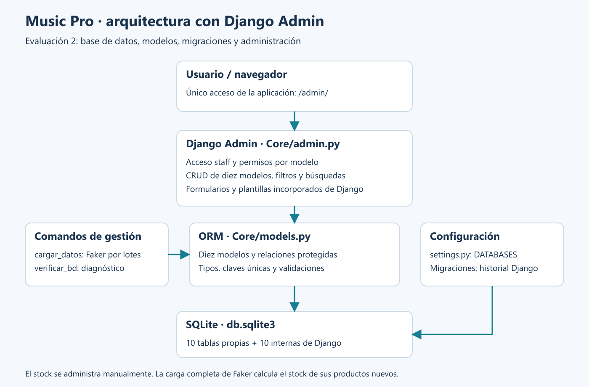
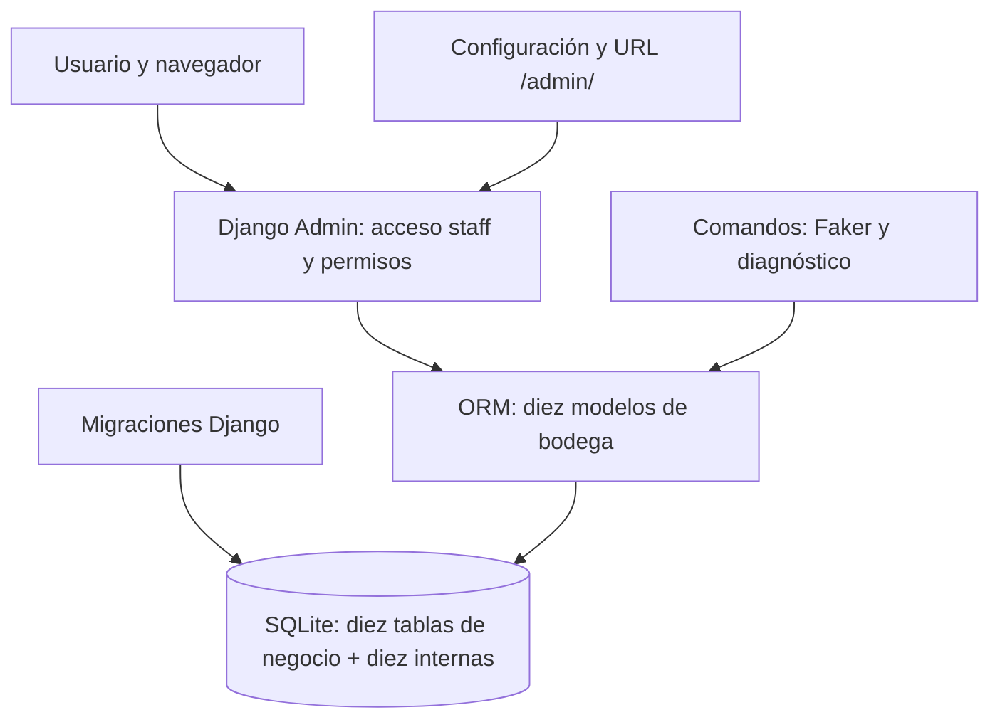
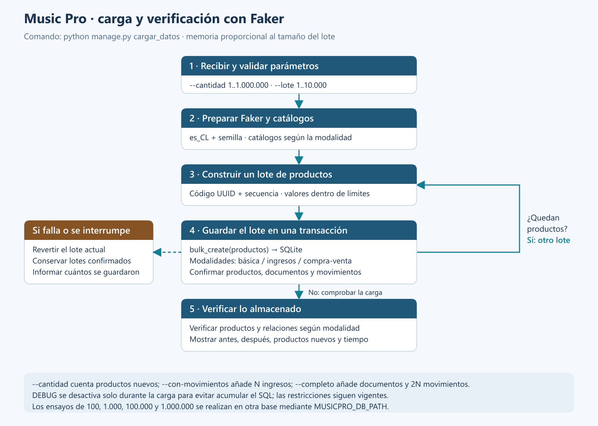
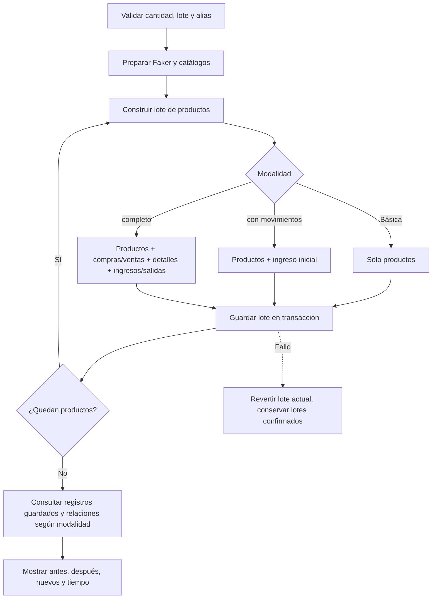

# Diagramas de Music Pro

**Sube [diagrama_bd.png](diagrama_bd.png)**: es una sola imagen del modelo de base de datos, exigida por la pauta E2 (páginas 9 y 11). Representa los diez modelos propios del negocio solicitados adicionalmente por el profesor y corresponde a los campos implementados en Django. Las diez tablas de usuarios, permisos y sesiones se explican por separado en [tablas_bd.md](tablas_bd.md).

| Diagrama | Uso | Archivos |
| --- | --- | --- |
| Base de datos | Imagen para la entrega: diez entidades, todos los campos, PK, FK, UK y cardinalidades | [PNG](diagrama_bd.png), [SVG](diagrama_bd.svg), [diccionario y Mermaid](diagrama_bd.md) |
| Arquitectura | Apoyo para explicar configuración, Admin, comandos, ORM y SQLite | [PNG](diagrama_arquitectura.png), [SVG](diagrama_arquitectura.svg) |
| Carga con Faker | Apoyo para explicar modalidades, lotes, transacciones y verificación | [PNG](flujo_carga.png), [SVG](flujo_carga.svg) |

La pauta solicita el diagrama de base de datos; los dos esquemas de apoyo son complementarios para la defensa. Los diagramas describen esta implementación propia de Music Pro.

## Arquitectura

## Generación de datos

Las cargas se suman y `--cantidad N` siempre cuenta productos nuevos. `--con-movimientos` añade un ingreso por producto; `--completo` añade un ingreso y una salida por producto junto con sus documentos, y calcula stock neto para esos productos nuevos. No actualiza automáticamente el stock cuando después editas documentos/movimientos desde Admin. Consulta [README_SEEDER.md](../README_SEEDER.md) para ejemplos y ensayos independientes.
